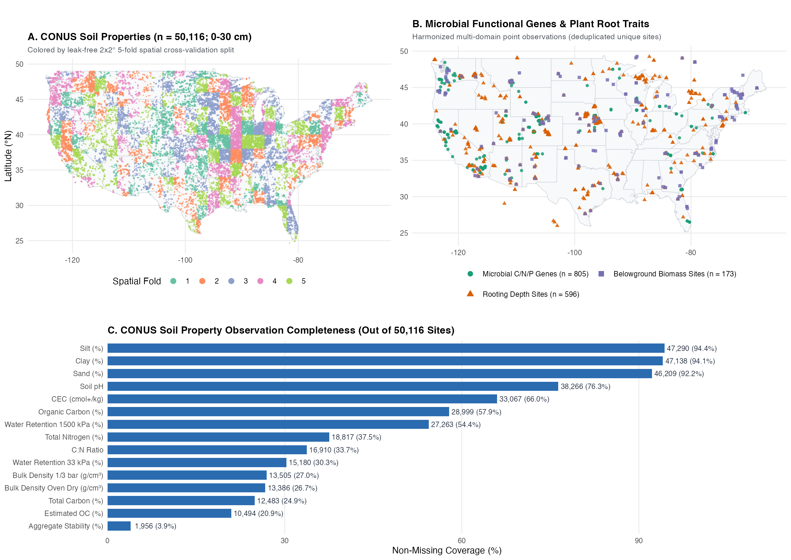

# CONUS Soil, Plant Root & Microbial Functional AI-Ready Database

[](https://github.com/sgautam77/MiracleAI/actions/workflows/validate_data.yml)
[](LICENSE-DATA)
[](LICENSE-CODE)
[](#repository-structure)
[](croissant.json)
[-teal.svg)](#dataset-overview)

An **AI-ready, multi-domain geospatial point database** uniting **50,116 topsoil (`0–30 cm`) physical and chemical observations**, **805 soil microbial C/N/P-degrading functional gene profiles**, and **plant root traits** (belowground biomass and rooting depth compiled from **FRED** and **TRY**) across the Contiguous United States (**CONUS**).

Designed out-of-the-box for machine learning, multi-task foundation models, pedotransfer function (PTF) development, and coupled terrestrial biogeochemical modeling:
- **Columnar & Relational Storage**: Snappy-compressed **Apache Parquet** (`data/parquet/`), a single indexed **SQLite** database (`data/sqlite/conus_soil_root_microbe.sqlite`), and original **CF-1.8 NetCDF** files (`data/raw_netcdf/`).
- **Clean Missingness & Harmonized Units**: All `-9999` NetCDF sentinel values decoded to native `NULL`/`NaN`; rooting depth harmonized across FRED (`cm`) and TRY (`m`); belowground biomass standardized to `g m-2`.
- **Leak-Free Spatial Cross-Validation**: Precomputed 2° × 2° geographic blocks (`spatial_block_id`) and balanced 5-fold spatial splits (`spatial_cv_fold`) shared consistently across **all** soil, root, and microbial tables, plus cross-database site deduplication (`is_primary_site_record`).
- **Non-Destructive Quality Control**: Raw measurements are preserved intact alongside explicit boolean `qc_*` flags for out-of-range percentages, texture sums, water retention inversions, and near-border coordinates.



---

## Dataset Overview

| Table Name | Domain | Total Rows | Unique Valid Sites | Key Target Variables | Parquet Path |
| :--- | :--- | ---: | ---: | :--- | :--- |
| **`soil_properties_conus`** | Topsoil Physics & Chemistry (`0–30 cm`) | 50,116 | 46,764 | 15 soil properties (Texture, pH, OC, TC, TN, C:N, CEC, Bulk Density, Water Retention, Aggregate Stability) | `data/parquet/soil_properties_conus.parquet` |
| **`microbe_enzymes_harmonized`** | Microbial Functional Genomics | 805 | 805 | Scaled (`0–1`) C-, N-, and P-degrading enzyme gene abundance | `data/parquet/microbe_enzymes_harmonized.parquet` |
| **`root_biomass_harmonized`** | Plant Root Traits (FRED+TRY) | 256 | 173 | Mean belowground biomass (`g m-2`) | `data/parquet/root_biomass_harmonized.parquet` |
| **`root_depth_harmonized`** | Plant Root Traits (FRED+TRY) | 1,062 | 596 | Mean rooting depth (`m` and `cm`) | `data/parquet/root_depth_harmonized.parquet` |

> **Full Schema & Datasheet**: See [`data/metadata/variable_dictionary.csv`](data/metadata/variable_dictionary.csv) for min/median/max/missingness of all 81 columns across the 4 tables, [`DATACARD.md`](DATACARD.md) for harmonization and leakage documentation, and [`croissant.json`](croissant.json) for MLCommons Croissant 1.0 metadata.

---

## Quickstart

### 1. Python & PyTorch Loader (Zero-Dependency or Pandas/PyArrow)

The included [`src/loaders/python_loader.py`](src/loaders/python_loader.py) automatically reads Parquet when `pandas` + `pyarrow` are installed and falls back cleanly to Python's built-in `sqlite3` module otherwise:

```python
from src.loaders.python_loader import (
    SOIL_TARGET_COLUMNS,
    SoilBiogeochemDatabase,
    build_pytorch_dataset,
)

db = SoilBiogeochemDatabase(".")

# 1. Leak-free 5-fold spatial train / val / test split on CONUS soil properties
train_df, val_df, test_df = db.get_spatial_split(
    "soil_properties_conus",
    test_fold=1,
    val_fold=2,
    exclude_qc_anomalies=True,  # optionally exclude 398 physically anomalous rows
)

# 2. Load deduplicated root traits strictly inside US CONUS borders (for PRISM/NLCD/gSSURGO joins)
root_depth_df = db.load_table(
    "root_depth_harmonized",
    deduplicate_sites=True,     # keeps 1 canonical record per unique site across FRED & TRY
    conus_only=True,            # excludes near-border Canada/Mexico points
)

# 3. Wrap in a Multi-Task PyTorch Dataset with missing-label boolean masks
train_ds = build_pytorch_dataset(
    train_df,
    target_cols=SOIL_TARGET_COLUMNS,
    feature_cols=("latitude", "longitude"),
)
sample = train_ds[0]
# sample["features"]    -> float32 tensor [lat, lon]
# sample["targets"]     -> float32 tensor (15,) with NaNs zero-filled
# sample["target_mask"] -> bool tensor (15,) True where ground-truth is observed
```

### 2. Direct Parquet Query (Pandas / Polars / DuckDB)

```python
import pandas as pd

soil = pd.read_parquet("data/parquet/soil_properties_conus.parquet")
microbe = pd.read_parquet("data/parquet/microbe_enzymes_harmonized.parquet")
```

```sql
-- DuckDB zero-copy query directly over Parquet
SELECT spatial_cv_fold,
       COUNT(*) AS n_obs,
       ROUND(AVG(organic_carbon_pct), 2) AS mean_oc_pct,
       ROUND(AVG(ph), 2) AS mean_ph
FROM 'data/parquet/soil_properties_conus.parquet'
WHERE NOT qc_any_anomaly
GROUP BY spatial_cv_fold
ORDER BY spatial_cv_fold;
```

### 3. SQLite Relational Database

```bash
sqlite3 data/sqlite/conus_soil_root_microbe.sqlite \
  "SELECT table_name, row_count, unique_sites, crs FROM dataset_catalog;"
```

### 4. R (`arrow` / `RSQLite` / `sf`)

```r
source("src/loaders/r_loader.R")

# Load as an sf geospatial object (EPSG:4326) with QC filtering
soil_sf <- load_ai_table(
  "soil_properties_conus",
  exclude_qc_anomalies = TRUE,
  as_sf = TRUE
)

# Retrieve leak-free spatial cross-validation folds
splits <- get_spatial_cv_split("microbe_enzymes_harmonized", test_fold = 1, val_fold = 2)
```

---

## Variable Summary

### A. CONUS Topsoil Properties (`soil_properties_conus`, `0–30 cm`, `n = 50,116`)

| Harmonized Column | Legacy NetCDF Var | Units | Valid Obs | Coverage | Min | Median | Max |
| :--- | :--- | :--- | ---: | ---: | ---: | ---: | ---: |
| `silt_pct` | `Silt` | `%` | 47,290 | 94.4% | 0.00 | 45.70 | 98.46 |
| `clay_pct` | `Clay` | `%` | 47,138 | 94.1% | 0.00 | 17.98 | 93.64 |
| `sand_pct` | `Sand` | `%` | 46,209 | 92.2% | 0.00 | 28.26 | 105.64* |
| `ph` | `pH` | `1` | 38,266 | 76.4% | 1.83 | 5.95 | 10.84 |
| `cec_cmolc_kg` | `CEC` | `cmol(+) kg-1` | 33,067 | 66.0% | 0.02 | 14.81 | 476.29 |
| `organic_carbon_pct` | `OC` | `%` | 28,999 | 57.9% | 0.00 | 1.27 | 61.83 |
| `water_retention_1500kpa_pct` | `Water_retension_15_bar` | `%` | 27,263 | 54.4% | 0.00 | 10.69 | 230.92 |
| `total_nitrogen_pct` | `T_nitrogen` | `%` | 18,817 | 37.5% | 0.00 | 0.14 | 32.35 |
| `cn_ratio` | `CN` | `1` | 16,910 | 33.7% | 0.00 | 11.17 | 771.24 |
| `water_retention_33kpa_pct` | `Water_retension_3bar` | `%` | 15,180 | 30.3% | 0.00 | 23.76 | 837.26 |
| `bulk_density_third_bar_g_cm3` | `BD_Third_bar` | `g cm-3` | 13,505 | 26.9% | 0.10 | 1.36 | 2.22 |
| `bulk_density_oven_dry_g_cm3` | `BD_oven_dry` | `g cm-3` | 13,386 | 26.7% | 0.21 | 1.49 | 2.42 |
| `total_carbon_pct` | `TC` | `%` | 12,483 | 24.9% | 0.01 | 1.91 | 62.54 |
| `estimated_organic_carbon_pct` | `Estimated_OC` | `%` | 10,494 | 20.9% | 0.00 | 1.75 | 62.51 |
| `aggregate_stability_pct` | `Aggregate_stability` | `%` | 1,956 | 3.9% | 0.00 | 36.00 | 103.78* |

*\*Values `>100%` (8 rows total) are retained unclipped for transparency and flagged via `qc_pct_gt_100 = TRUE` (and `qc_any_anomaly = TRUE`).*

### B. Microbial Functional Genes & Plant Root Traits

| Table | Harmonized Column | Units | Valid Obs | Min | Median | Max |
| :--- | :--- | :--- | ---: | ---: | ---: | ---: |
| `microbe_enzymes_harmonized` | `c_degrading_rel_abundance` | `0–1` (scaled) | 804 | 0.0000 | 0.0502 | 1.0000 |
| `microbe_enzymes_harmonized` | `n_degrading_rel_abundance` | `0–1` (scaled) | 805 | 0.0000 | 0.0015 | 1.0000 |
| `microbe_enzymes_harmonized` | `p_degrading_rel_abundance` | `0–1` (scaled) | 804 | 0.0000 | 0.2006 | 1.0000 |
| `root_biomass_harmonized` | `belowground_biomass_g_m2` | `g m-2` | 256 (173 unique sites) | 12.59 | 825.13 | 10,420.00 |
| `root_depth_harmonized` | `rooting_depth_m` | `m` | 1,061 (596 unique sites) | 0.01 | 1.34 | 53.00 |
| `root_depth_harmonized` | `rooting_depth_cm` | `cm` | 1,061 (596 unique sites) | 1.00 | 133.50 | 5,300.00 |

---

## Repository Structure

```text
.
├── README.md                          # Overview, quickstart, and variable summary
├── DATACARD.md                        # AI Datasheet: provenance, QC flags, and ML leakage notes
├── croissant.json                     # MLCommons Croissant 1.0 machine-readable JSON-LD metadata
├── CITATION.cff                       # Citation metadata for GitHub
├── LICENSE                            # Dual license summary (CC-BY-4.0 data / MIT code)
├── LICENSE-DATA                       # CC-BY-4.0 data license & upstream attribution requirements
├── LICENSE-CODE                       # MIT software license
├── requirements.txt                   # Optional Python ML dependencies
├── figures/
│   └── spatial_coverage_overview.png  # Spatial distribution & completeness overview figure
├── data/
│   ├── parquet/                       # Primary AI-ready Snappy-compressed Parquet tables
│   │   ├── soil_properties_conus.parquet
│   │   ├── microbe_enzymes_harmonized.parquet
│   │   ├── root_biomass_harmonized.parquet
│   │   ├── root_depth_harmonized.parquet
│   │   └── individual/                # Direct 1-to-1 cleaned Parquet mirrors of each NetCDF file
│   ├── sqlite/
│   │   └── conus_soil_root_microbe.sqlite  # Indexed relational SQLite database + metadata views
│   ├── metadata/
│   │   ├── variable_dictionary.csv    # Column-level schema, units, missingness & summary stats
│   │   ├── dataset_summary.json       # High-level row, spatial fold, and QC counts
│   │   └── checksums.sha256           # SHA-256 cryptographic hashes of all data files
│   └── raw_netcdf/                    # Original unmodified CF-1.8 NetCDF files
└── src/
    ├── build_database.R               # Reproducible NetCDF -> Parquet + SQLite + metadata pipeline
    ├── validate_database.R            # Automated data integrity & leak-free split verification
    └── loaders/
        ├── python_loader.py           # Python / Pandas / SQLite / PyTorch multi-task data loader
        └── r_loader.R                 # R arrow / RSQLite / sf spatial data loader
```

---

## Reproducing & Verifying the Database

To rebuild all derived Parquet, SQLite, metadata, and figure artifacts from `data/raw_netcdf/` and run the full integrity test suite:

```bash
Rscript src/build_database.R
Rscript src/validate_database.R
python3 src/loaders/python_loader.py --self-test
```

---

## Attribution & License

- **Data (`data/`, `figures/`, `DATACARD.md`, `croissant.json`)**: Licensed under **[CC-BY-4.0](LICENSE-DATA)**.
- **Code (`src/`, `requirements.txt`)**: Licensed under **[MIT](LICENSE-CODE)**.

When publishing work using this database, please cite this repository (see [`CITATION.cff`](CITATION.cff)) as well as the relevant upstream primary observational compilations:
- **CONUS Soil Observations**: Harmonized 0–30 cm CONUS soil pedon compilations (e.g., USDA-NRCS NCSS / RaCA master datasets).
- **FRED (Fine-Root Ecology Database)**: Iversen, C. M., et al. (2017). *A global Fine-Root Ecology Database to address below-ground challenges in plant ecology*. New Phytologist, 215(1), 15–26. https://roots.ornl.gov/
- **TRY Plant Trait Database**: Kattge, J., et al. (2020). *TRY plant trait database – enhanced coverage and open access*. Global Change Biology, 26(1), 119–188. https://www.try-db.org/
- **Soil Microbial Functional Genes**: Scaled relative abundance compilations of C-, N-, and P-degrading microbial enzyme encoding genes across CONUS.
